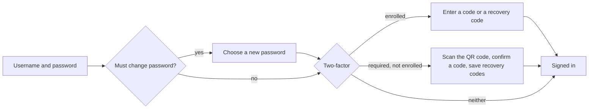

# Users, sign-in and roles

Status: built.

Until now the builder has assumed one officer working alone, with no session (`docs/admin.md`). This plan adds accounts, sign-in with an optional second step, and roles, without a mail server or any other service: one install is still one process and one database.

## Decisions

| Question                | Decision                                                                                                                                                      |
| ----------------------- | ------------------------------------------------------------------------------------------------------------------------------------------------------------- |
| Sign-in                 | Username and password. No email addresses, no mail server                                                                                                     |
| The first account       | A super admin, seeded from the environment on first boot only, who must change the password at first sign-in. After that it's managed in the admin            |
| New accounts            | An Admin (or the super admin) makes a one-time invite link with the role already chosen, and hands it over. The person picks their username and password      |
| Two-factor              | TOTP (an authenticator app). The super admin turns on "Require two-factor" in Settings; everyone, the super admin included, then enrols at their next sign-in |
| Sessions                | A random token in an HttpOnly cookie, stored hashed in `site.db`. No JWTs. Signed out after 8 hours idle and 7 days in any case                               |
| Roles                   | Editor, Content Manager, Admin, and one super admin above them. Each includes everything the one below can do                                                 |
| Review                  | No new workflow state. Editors save drafts; the Publishing screen's list of waiting changes, which gains "last edited by", is the Content Manager's queue     |
| Lost password or device | An Admin makes a one-time reset link, or clears the person's two-factor so they enrol again. The super admin recovers from the server: `laman reset-password` |
| Attribution             | Revisions, publishes, media and site document drafts record who made them, and an audit log records sign-ins, account changes and publishing                  |

## Roles

| Can                                                                                                                         | Editor | Content Manager | Admin | Super admin |
| --------------------------------------------------------------------------------------------------------------------------- | :----: | :-------------: | :---: | :---------: |
| See everything in the admin: pages, history, media, site documents, Publishing, analytics                                   |   ✓    |        ✓        |   ✓   |      ✓      |
| Create, edit and duplicate pages and entries; restore an old revision into the draft; make a listing                        |   ✓    |        ✓        |   ✓   |      ✓      |
| Move, rename, delete and restore from the trash pages that have never been published (nor anything under them)              |   ✓    |        ✓        |   ✓   |      ✓      |
| Edit and discard the drafts of navigation, site settings, the announcement, search and colours                              |   ✓    |        ✓        |   ✓   |      ✓      |
| Upload media, edit its details (alt text, caption, credit), and delete or restore a file nothing uses                       |   ✓    |        ✓        |   ✓   |      ✓      |
| Publish pages and site documents, now or scheduled; unpublish; move, delete or restore pages that are on the site           |        |        ✓        |   ✓   |      ✓      |
| Replace a media file, or put back the one it replaced (these change the live site at once)                                  |        |        ✓        |   ✓   |      ✓      |
| Cancel a scheduled publish                                                                                                  |        |        ✓        |   ✓   |      ✓      |
| Undo a publish, rebuild the whole site, retry a failed job, back up now                                                     |        |                 |   ✓   |      ✓      |
| Change what pages may embed: built-in services and the site's own hosts (Settings, Embeds)                                  |        |                 |   ✓   |      ✓      |
| Invite people, change their role, make reset links, clear two-factor, disable accounts, sign people out; read the audit log |        |                 |   ✓   |      ✓      |
| Turn "Require two-factor" on or off                                                                                         |        |                 |       |      ✓      |

Restoring a backup isn't in the admin at all: it replaces every account, so it's done from the command line by whoever runs the server (`laman restore`, [laman.md](laman.md) § Restore).

Rules around the table:

- There is exactly one super admin. It can't be invited, assigned, disabled or changed by anyone else, and Admins can't touch it.
- Nobody changes their own role or disables themselves, so an Admin can't lock themselves out by mistake.
- Accounts are disabled, never deleted, so history keeps saying who did what. Disabling signs the person out everywhere.
- The line between Editor and Content Manager is "does this change the live site at once?". Moving or deleting a page that's on the site does, and so does replacing a media file; doing the same to a page nobody has published, or deleting a file nothing uses, doesn't. So an Editor can tidy up their own new pages, and the server checks the page and everything under it (`onlyUnpublished`, a `preHandler` on those routes in `apps/server/src/routes/pages.ts`). The server refuses a file that's in use anyway.

## How it works

### Accounts

- **Usernames:** 3–32 characters of `a–z`, `0–9`, `.`, `_` and `-`, stored in lower case and unique. A display name (shown in history and the user menu) can be anything.
- **Passwords:** 12–128 characters with no other composition rules (NIST 800-63B), not the username, not in a short bundled list of common passwords. They are hashed with argon2id using Node's built-in `crypto.argon2` (Node 24.7 and later, so `engines` moves to `>=24.7`), so no native module is added.
- **The super admin:** on a boot where no super admin exists, `SUPER_ADMIN_USERNAME` and `SUPER_ADMIN_PASSWORD` create one, marked to change its password at first sign-in. With neither set, the server refuses to start with a message saying so. After that both variables are ignored, so the password an operator could read in the environment stops working once it's changed. The docs say to remove them.

### Signing in

- A session starts at the password step with a **stage**: `password` (must change it), `totp` (enter a code), `enrol` (set up two-factor) or `full`. Every route except the ones for its current stage answers `401 signed_out` until the stage is `full`. A stage before `full` expires after 10 minutes.
- **Wrong username or wrong password** get the same message and the same time to answer, since an unknown username is still checked against a fixed dummy hash.
- **Rate limits** (`apps/server/src/auth/throttle.ts`, in memory) count each try as it starts, so a burst sent at once can't slip past while the password is checked; a success forgets them. Per address, and per username from that address: after 5 tries each waits twice as long, up to 15 minutes. Per username alone, which anyone can type from anywhere: after 20, up to a minute, so guessing one account from many addresses slows down but nobody can keep an officer out for long. Two-factor codes, at sign-in, when setting it up and for new recovery codes, share one limit per person. There is no permanent lockout. The addresses come from `TRUST_PROXY`.
- **One-time links** are used up inside the transaction that uses them, so two requests sent at once with one link can't both succeed.
- **The session id changes** on every stage change and on every password change.

### Sessions

- **The cookie:** `__Host-sb_session` (`sb_session` over plain HTTP in development), `HttpOnly`, `Secure` outside development, `SameSite=Lax`, `Path=/`. It holds 32 random bytes. `site.db` keeps only their SHA-256, so a leaked backup holds no usable sessions.
- **Expiry:** 8 hours without a request, and 7 days after sign-in in any case. `last_seen_at` is updated at most once a minute.
- **Sign out** ends this session. Changing a password, resetting it, clearing two-factor, changing a role and disabling an account end all of that person's sessions. The Account screen lists your own sessions (browser, IP, last seen) so you can end them.
- **CSRF:** the API only accepts a request that changes something (POST, PUT, PATCH or DELETE) when `Sec-Fetch-Site` is `same-origin`, or when `Origin` matches the host if the browser doesn't send that header. Together with `SameSite=Lax`, that's enough for a same-origin SPA without a token. Cookie sessions need the admin on the same origin as the API, so `CORS_ORIGIN` stops being useful for the admin. It stays only for API clients that don't send credentials.

### Two-factor

- **TOTP** (RFC 6238): SHA-1, 6 digits, 30-second steps, accepted one step either side. A code is refused if its step was already used, so a code that was seen can't be replayed. It's about 40 lines on `node:crypto`, with no dependency.
- **Enrolment** shows a QR code of the `otpauth://` address, drawn in the admin, plus the secret as text, then asks for one code to confirm. It then shows **10 recovery codes** once. Each works once, and they are stored hashed. Recovery codes can be regenerated from the Account screen.
- **The setting:** "Require two-factor" lives on Settings, in a Security section only the super admin sees. It's a builder setting, not a drafted site document, so it applies on save. The super admin must have enrolled before turning it on. Turning it on moves every signed-in session without two-factor to the `enrol` stage at once, in one update, so the request path never checks the setting.
- **Once someone has enrolled, they're always asked for a code**, even if the requirement is turned off later. Turning the requirement off doesn't remove anyone's two-factor.
- TOTP secrets are stored as they are in `site.db`. A backup is therefore as sensitive as the password hashes it already holds; the backup docs say so.

### One-time links

Invites and password resets are the same kind of link: 32 random bytes, stored hashed, used once.

| Link   | Made by                                       | Lasts    | Opens                                                             |
| ------ | --------------------------------------------- | -------- | ----------------------------------------------------------------- |
| Invite | Admin, super admin                            | 72 hours | `/admin/join#<token>`: pick a username, display name and password |
| Reset  | Admin, super admin, or `laman reset-password` | 24 hours | `/admin/reset#<token>`: pick a new password                       |

- **The token travels in the URL fragment**, so it never reaches the server's or a proxy's access log, nor a `Referer`. The admin reads it and posts it.
- **The admin shows the link once**, with a copy button, its expiry and who it's for; closing it before copying asks first. Pending invites can be listed and revoked, and invites that expired in the last 7 days stay on the list, to make again or remove.
- **Using a reset link** ends the person's sessions. Two-factor stays as it was unless an Admin cleared it as well.
- **The CLI covers the super admin:** `laman reset-password <username>` prints a reset link, and `laman clear-2fa <username>` clears two-factor. Both work on any account, for the operator on the server.

### Authorisation

- **Permissions, not roles, in the code.** `packages/contracts` gets `Role`, a short list of permissions (`content.edit`, `content.publish`, `site.manage`, `users.manage`, `security.manage`) and the lowest role that has each one. The admin and the server read the same table.
- **Every `/api` route declares its permission** in its route config, e.g. `config: { permission: "content.publish" }`, or `"signedIn"` for reads. A hook enforces it. A route with no permission declared is refused, and a test lists every route to check it declares one. That's the same way the OpenAPI document already reads each route's schema, and the permission appears there too.
- **Errors:** `401 signed_out` without a full session, and `403 forbidden` with the permission it needed.
- **What stays public:** the published site, `POST /_v`, `/healthz`, `/pagefind` and `/carian`. Everything else needs a session: `/api`, `/render` (the canvas, same-origin, with the cookie), `/media/` (the library; the published site has its own copies), `/docs` and `/openapi.json`.
- **The admin hides what you can't do** (Publish buttons, the Users screen, the Security section) with `useCan(permission)` from `/api/auth/me`. The server's check is what counts. A button is hidden rather than disabled when the person can never use it.

### Attribution and the audit log

- **`created_by` / `updated_by`** on revisions, jobs, media and pages (who last edited the draft), and on settings rows. The Publishing list's "last edited by" and history's "who" read these. Rows from before this change say nobody.
- **The audit log** (`audit_log`: when, who, action, target, detail JSON, IP) records:
  - sign-ins and failed sign-ins, and signing out;
  - password changes and resets;
  - two-factor enrolled or cleared;
  - invites made, revoked and used;
  - role changes, disabling and enabling;
  - the two-factor requirement turned on or off;
  - publish, unpublish, undo, delete and restore.
  - API tokens made and revoked.

  Admins read it on the Users screen, filtered by person and action. It's kept for a year and pruned by the existing job queue.

- **Admin preferences** (the admin's language) become each person's own, a column on `users`. The current global `preferences` row becomes the super admin's when it's seeded.

### API tokens

For a program that writes with no one at the keyboard, such as a nightly import from another system. An agent over MCP (docs/mcp.md) needs an officer to allow it in a browser and lasts 7 days, so it can't run a sync.

- **Made by an Admin** under Users, API tokens: a name ("People sync"), a role (Editor or Content Manager, never more), the areas it may change (below), and how long it lasts (at most a year, or until it's revoked: `days: null`, `expires_at` null). The secret starts `laman_`, is shown once, and only its SHA-256 is stored.
- **Its own account.** Each token has a row in `users` with `kind` "token", its name as the display name and its role. It can't sign in (its username, `token:<id>`, isn't a valid one, and sign-in only looks up people), isn't on Users and can't be changed there. Because it's an ordinary account to the rest of the code, revisions, jobs, Publishing and the audit log credit the token by name with no changes of their own.
- **Sent as** `Authorization: Bearer laman_…` to `/api`. The guard runs the request as the token's account, through the same permission checks, validation and draft conflicts as the admin. A wrong, expired or revoked token gets `401 token_invalid`. No cookie rides along with a token, so the same-origin check for cookie sessions is skipped. Tokens can't use `/api/auth/`.
- **Reads follow the role,** as for people: a token can read anything its role can, which is most of the API.
- **Changes follow its areas.** An Admin ticks what it may change, stored in `api_token_areas`; its role still decides whether it may publish (an Editor's token only drafts):

  | Area      | What it may change                                                                                                                          |
  | --------- | ------------------------------------------------------------------------------------------------------------------------------------------- |
  | `entries` | Entries under the listings in `api_token_listings` (at least one), and new ones there. Dropped when `pages` is given too, which covers them |
  | `pages`   | Any page or entry, and the page tree (new pages, moves, deletes, listing settings)                                                          |
  | `media`   | The media library                                                                                                                           |
  | `site`    | Navigation, settings, the announcement, search and colours                                                                                  |

- **Closed by default.** A route that changes something says which area it belongs to with `config.tokenScope`; any other is `403 token_not_allowed` (bulk publishing, undo, rebuilds, calendar sources, jobs, backups, people). The scopes:

  | `tokenScope` | Routes                                                                                   | Allowed with                                                    |
  | ------------ | ---------------------------------------------------------------------------------------- | --------------------------------------------------------------- |
  | `page`       | One page's draft, publish, unpublish, delete, restore, discard, and restoring a revision | `pages`, or `entries` when `:id` is an entry under its listings |
  | `entries`    | `POST /pages/:id/entries`                                                                | `pages`, or `entries` when `:id` is one of its listings         |
  | `pages`      | New pages, moves, duplicates, listing settings, making a listing                         | `pages`                                                         |
  | `media`      | Every change to the media library                                                        | `media`                                                         |
  | `site`       | Saving, discarding and publishing the site documents                                     | `site`                                                          |

  A change outside its areas is `403 outside_token_scope`.

- **Revoking** stops it at once and takes it off the API tokens screen. The account stays, so history and the audit log keep its name. `GET /api/tokens` still returns revoked tokens, so the audit log can filter by them. `last_used_at` is written at most once a minute.

## Data

These tables are part of `0001_baseline` (`docs/upgrades.md` § The baseline).

| Table            | Holds                                                                                                                                                                     |
| ---------------- | ------------------------------------------------------------------------------------------------------------------------------------------------------------------------- |
| `users`          | id, username, display name, role, password hash, must-change flag, TOTP secret and last used step, enrolled at, preferences, disabled at, last sign-in, created at and by |
| `sessions`       | token hash, user, stage, created, last seen, expires, IP, user agent                                                                                                      |
| `tokens`         | token hash, kind (invite or reset), the role (invite) or the user (reset), made by, expires, used at                                                                      |
| `recovery_codes` | user, code hash, used at                                                                                                                                                  |
| `audit_log`      | at, user, action, target, detail, IP                                                                                                                                      |

Plus `created_by` and `updated_by` columns on the tables above, and a `security` settings row (`{ "requireTwoFactor": false }`). The new JSON, `users.preferences` and the `security` row, goes in `storedDocuments` (`apps/server/src/db/documents.ts`), so the upgrade check covers it. The `preferences` row leaves that list.

## API

| Route                                                                                      | Who                                    |
| ------------------------------------------------------------------------------------------ | -------------------------------------- |
| `POST /api/auth/sign-in`, `/sign-out`                                                      | anyone; signed in                      |
| `GET /api/auth/me`: the person, role, permissions and stage                                | any stage                              |
| `POST /api/auth/password`: change it, needs the current one except at the `password` stage | `password` stage, signed in            |
| `GET /api/auth/totp/setup`, `POST /api/auth/totp/enrol`, `POST /api/auth/totp`             | `enrol` stage, signed in; `totp` stage |
| `POST /api/auth/recovery-codes`: make new ones                                             | signed in, needs a current code        |
| `POST /api/auth/join`, `POST /api/auth/reset`: use a link                                  | anyone with the token                  |
| `GET /api/auth/sessions`, `DELETE /api/auth/sessions/:id`: your own                        | signed in                              |
| `GET /api/users`, `PATCH /api/users/:id`: role, display name, disabled                     | `users.manage`                         |
| `POST /api/users/invites`, `GET` the pending ones, `DELETE /api/users/invites/:id`         | `users.manage`                         |
| `POST /api/users/:id/reset-link`, `/clear-2fa`, `/sign-out`                                | `users.manage`                         |
| `GET /api/audit`                                                                           | `users.manage`                         |
| `GET /api/security`, `PUT /api/security`                                                   | signed in; `security.manage`           |
| `GET /api/tokens`, `POST /api/tokens`, `DELETE /api/tokens/:id`: API tokens                | `users.manage`                         |

The existing routes get their permissions from the roles table above. For example, `PUT /pages/:id/draft` needs `content.edit`, `POST /pages/:id/publish` needs `content.publish`, and `POST /publish/:id/undo` needs `site.manage`.

## Admin

- **Signed-out screens,** outside the shell: Sign in, the two-factor code, Set up two-factor (the QR code, the secret, the recovery codes), Choose a new password, Join (invite), and Reset. Any route sends someone who isn't signed in to Sign in, and back to the page they wanted afterwards.
- **The user menu** in the shell shows the name and role, and links to Account and Sign out.
- **Account:** your display name, password, two-factor (recovery codes), sessions and language.
- **Users** (Admins): people with their role, status (active, inactive after 90 days without signing in, disabled), two-factor and last sign-in; Invite (choose the role, then copy the link); pending invites; and per person, change role (a dialog that shows what the role can do), reset link, clear two-factor, sign out everywhere, view their activity, disable. API tokens sit beside it (make one, copy its secret once, revoke). A revoked token leaves the list; the audit log keeps it, and an expired one stays until it's revoked. The Audit log sits beside it: it names the person or page each entry was about and what changed, filters by person, action and day, and downloads as CSV.
- **Settings:** a Security section for the super admin, with the "Require two-factor" switch.
- **Publishing and history** show who: "last edited by" on waiting items, and the person on each revision and publish.
- All text through `t()`. The QR code comes from a small pure-JS library added to the catalog.

## Where the code is

| Path                                         | What                                                                                                                                                                             |
| -------------------------------------------- | -------------------------------------------------------------------------------------------------------------------------------------------------------------------------------- |
| `packages/contracts/src/auth.ts`             | Roles, permissions and the lowest role for each (`can`), and the auth API's schemas                                                                                              |
| `apps/server/src/auth/`                      | Passwords, TOTP, tokens, sessions, the throttle, the audit log, seeding, and the guard                                                                                           |
| `apps/server/src/auth/guard.ts`              | `config.access` on every route, checked per request; a route without one stops the server at boot. `audited(request, …)` records what a request did, written only if it succeeds |
| `apps/server/src/auth/acting.ts`             | Who the request (or a queued job) acts for, so revisions, jobs, uploads and drafts record it                                                                                     |
| `apps/server/src/routes/auth.ts`, `users.ts` | The sign-in steps and your own account; people, invites, the audit log and the security setting                                                                                  |
| `apps/server/test/helpers.ts`                | `signedInApp(options, role)`: the app with every `inject` signed in, for tests                                                                                                   |
| `apps/admin/src/lib/auth.ts`                 | The API client, `useMe` and `useCan`                                                                                                                                             |
| `apps/admin/src/auth/`                       | The screens before the admin: sign-in and its steps, two-factor setup, Join and Reset                                                                                            |
| `apps/admin/src/users/`, `src/account/`      | Users and the audit log; Account                                                                                                                                                 |

The router (`apps/admin/src/router.tsx`) sends anyone without a finished sign-in to Sign in, or the step they're at, and back to where they were going after.

## Not in this plan

- Signing in through the agency's directory (SAML, OIDC, LDAP). The permission table doesn't depend on how someone signed in, so it can be added later.
- Passkeys (WebAuthn) as a second step.
- Email for invites and resets, which `docs/laman.md` lists as optional SMTP.
- Per-page permissions, e.g. an Editor limited to one section of the site.
