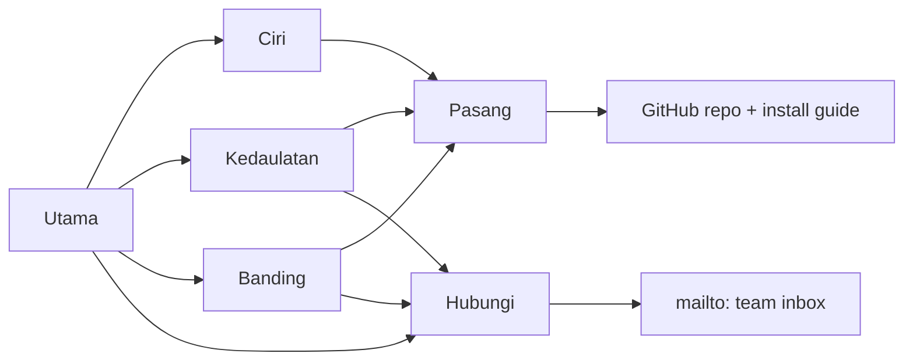

# Brief: the Laman marketing site

Status: phases 1 and 2 done, 4 Nov 2026. The copy for Utama, Kedaulatan, Banding and Pasang is in `apps/www/src/content/pages/{ms,en}/`; `apps/www` builds and has a GitHub Pages workflow, and renders each page as FTDS prose until the section components (phase 3) replace it.

A static site that makes a Malaysian government agency want to try Laman instead of starting (or staying) on WordPress, Joomla or Drupal. Hosted on GitHub Pages, built from this monorepo.

## Decisions so far

| Question         | Decision                                                                                                                                           |
| ---------------- | -------------------------------------------------------------------------------------------------------------------------------------------------- |
| Build            | A new Astro app, `apps/www`, on the same FTDS Astro components the renderer uses. Static output, deployed by a GitHub Actions workflow to GH Pages |
| Conversion paths | 1. Install it: the GitHub repo and the Docker Compose guide. 2. Contact the team: a `mailto:` address (placeholder until we have the inbox)        |
| Language         | BM first at `/`, English at `/en`, every page in both                                                                                              |
| Licence          | Open source (MIT proposed). A `LICENSE` file lands in the repo before the site goes live; the site never claims a licence the repo doesn't have    |
| Competitors      | Named, factually: WordPress, Joomla, Drupal. No mockery, nothing we can't point at a source for                                                    |
| Attribution      | Neutral for now. No ministry name or crest; one slot in the footer and the About section to fill after approval                                    |

## Who the site is for

Not the same people as the product's users. The person who decides to try Laman is rarely the officer who will run it.

| Reader                                                 | What they need to believe                                                                      | Where they get it              |
| ------------------------------------------------------ | ---------------------------------------------------------------------------------------------- | ------------------------------ |
| **Head of ICT / CIO** (decides, installs)              | It's small, safe, ours to run, cheap to keep up, and won't become next year's patching problem | Sovereignty, Security, Install |
| **Head of corporate communications** (owns the site)   | My team can publish without a vendor ticket, and the site will look and read well              | Product tour, For officers     |
| **Director / approver** (signs off)                    | It's accountable: who did what, nothing goes public by accident, nothing leaks visitors' data  | Accountability, Privacy        |
| **The officer** (will use it)                          | It's easy, and it won't let me make a mistake I'll be blamed for                               | Product tour                   |
| **Vendors and integrators** (often build agency sites) | I can install, support and extend this for my clients                                          | Install, GitHub                |

Each page answers one of these readers first. The home page has to hook the first two in one screen.

## The philosophy, in the site's own words

The product docs (`PRODUCT.md`, `docs/project-context.md`) are clear about what Laman believes. The marketing site should say these out loud, because they are what WordPress, Joomla and Drupal don't offer:

1. **The accessible way is the easy way.** Officers arrange approved FTDS blocks. There's no free styling, no custom HTML and no plugins, so the design system's accessibility can't be routed around. When Laman refuses something, it says why and offers the accessible way.
2. **Made for the officer who runs the website on top of their real job,** and who might be transferred in two years. Laman teaches itself: plain labels, help where it's needed, no manual or trainer required.
3. **What you see is what visitors get.** One renderer draws the editor, the preview and the published site.
4. **Nothing goes public by accident, and everything can be undone.** Drafts, checks before publishing, history, restore, undo publish, redirects when a page moves.
5. **The visitor most in need sets the bar.** Elderly, low-literacy, disabled and stressed visitors on old phones and slow connections.
6. **Honest about what it checks.** Laman says what it can't judge (whether alt text is good, what a PDF contains) instead of showing a green tick.
7. **No tracking, no dark patterns.** It's a public service.

The site itself must live by all seven. A marketing site for an accessibility-first product with a carousel, a cookie banner or a 3 MB hero video would undo the argument.

## Sovereign technology: the central argument

"Sovereign" should mean something concrete here, not a slogan. Five layers, each backed by something real in the code:

| Layer                  | What it means for an agency                                                                                                                                                                                  | Backed by                                                                                           |
| ---------------------- | ------------------------------------------------------------------------------------------------------------------------------------------------------------------------------------------------------------ | --------------------------------------------------------------------------------------------------- |
| **Data**               | Content, accounts, history and visitor figures stay in your data centre. Nothing calls out: no CDN, no outside lookups, works without internet access                                                        | Single tenant, self-hosted; analytics in `analytics.db`; "Nothing calls out" in `docs/analytics.md` |
| **Code**               | Open source. Read it, audit it, run it, change it, keep running it if the original team disappears                                                                                                           | MIT licence (to add); public repo                                                                   |
| **Operations**         | One process, one SQLite file, one Docker image. Your ICT team can run it without a vendor. Your published site is plain HTML that any web server can serve, and keeps working if the builder is switched off | `docs/site-builder.md` § Shape, Deployment; `docs/install-docker.md`                                |
| **Design**             | Built on FTDS, a Malaysian design system, BM by default                                                                                                                                                      | FTDS v0.2.2; site content BM by default                                                             |
| **Skills and control** | Officers publish themselves instead of raising vendor tickets. AI agents can help, but only as the officer, with the officer's permissions, logged, and with any MCP client rather than one vendor's         | `docs/mcp.md`                                                                                       |

The one-line version for the hero: **Laman web agensi anda, di pelayan anda, dalam kawalan anda.** ("Your agency's website, on your servers, under your control.")

## What we can claim, and what we can't

Every claim on the site comes from this table. Anything not in it needs a source before it goes in.

**Can say (built, in the code or docs):**

- 26 FTDS blocks; page kinds (page, listing, entry) that limit which blocks fit; templates with real BM starting content (Utama, Perkhidmatan, Hubungi, Berita, Pengumuman, Tender dan sebut harga, Acara).
- Live canvas editing with inline text, a property panel, undo and redo, and a preview identical to the published page.
- Checks before publishing: a page with no h1 can't go live; warnings for missing or meaningless alt text ("IMG_2041.png", "gambar"), "klik sini" links, broken links, and template text left in.
- Static output: incremental publishing, atomic swap (a failed build leaves the live site untouched), brotli and gzip at publish (home page about 32 KB to 7 KB), a 404 page, sitemap, RSS.
- Site search with Pagefind: no search server, filters by collection and category, pinned results.
- Site colours: a preset or the agency's own colour, with the shades generated and contrast-checked so they pass WCAG AA. The server refuses a colour ramp that fails.
- Roles (Editor, Content Manager, Admin, super admin); the line is "does this change the live site at once?". TOTP two-factor that the super admin can require; an audit log; accounts disabled, never deleted, so history keeps who did what. No mail server needed.
- Drafts that can't be overwritten by someone else's save; unsaved work kept through a crash or an expired sign-in.
- Scheduled publishing, publish history, restore an old version, undo a publish, redirects on move, Recently deleted.
- Media: required alt text, metadata (including location) stripped from photos, responsive sizes, unsafe SVG refused.
- Cookie-free analytics: no cookies, no IP addresses stored, no identifier that lasts beyond a day, Global Privacy Control honoured, so no consent banner (PDPA 2010).
- Backups every day, before every upgrade, and on demand; each one checked when it's made; restore and test restore from the command line.
- Upgrades that snapshot the database first and put it back if a migration fails; content is checked against the current schemas before the server starts.
- AI agents over MCP: about 80 tools, OAuth sign-in as the officer, off until an Admin allows it, every call in the audit log, any connection revocable.
- Docker Compose install with optional Caddy for HTTPS.
- The admin in Bahasa Melayu or English (`apps/admin/src/i18n`).

**Can't say (not built, not true, or not known):**

- BM and EN edited side by side (a second language slot exists; side-by-side editing isn't built).
- An approval workflow (there isn't one; the Content Manager's waiting list is the review step).
- A native or systemd install (Docker only).
- "WCAG compliant" or "certified". Say "designed to WCAG 2.2 AA" and "checks before publishing", and say what's left to the officer.
- SPLaSK or any government assessment score. Out of scope for the product.
- Adoption figures, agency logos, testimonials or quotes. None exist. The pilot is our own site. Sections that would hold these are left out, not filled with placeholders.
- Performance or security numbers we haven't measured on the marketing site itself.

## Site map

```
/                        Utama (home)
/ciri                    Ciri-ciri (product tour)
/kedaulatan              Teknologi berdaulat (sovereignty)
/keselamatan             Keselamatan dan privasi (security and privacy)
/kebolehcapaian          Kebolehcapaian (accessibility)
/ejen-ai                 Ejen AI (agents over MCP)
/banding                 Laman berbanding WordPress, Joomla dan Drupal
/pasang                  Pasang (install)
/soalan-lazim            Soalan lazim (FAQ)
/hubungi                 Hubungi kami (contact)
/en/...                  The same pages in English (/en/features, /en/sovereignty, ...)
```

Navbar: Ciri · Kedaulatan · Banding · Pasang, then a filled **Pasang Laman** button and a language switch. Everything else is in the footer. Ten pages is enough: a decision maker reads the home page and one or two others.

## Page by page

### Utama (home)

One screen per section, in this order. Each section ends with a way forward.

1. **Hero.** Headline: the sovereignty line above. Subline: "Laman ialah pembina laman web sumber terbuka untuk agensi kerajaan. Pegawai menyusun blok FTDS, menekan Terbit, dan laman statik yang pantas dan mudah diakses terus ke udara, di pelayan agensi sendiri." Two buttons: **Pasang Laman** (filled) and **Lihat cara ia berfungsi** (to the tour). Beside it: a real screenshot of the editor canvas with an inline edit in progress, not an illustration.
2. **The problem, without naming anyone yet.** Three short cards, each a pain an ICT head recognises: plugins to patch every month; a vendor ticket for every change; a site that looks different on every page because anyone could style anything. Plain, not alarmist.
3. **How it works in three steps** (FTDS Steps): Susun blok → Semak → Terbit. Under it, one line: "Laman web yang diterbitkan ialah HTML statik. Ia terus berfungsi walaupun pembina dimatikan."
4. **Sovereignty band.** The five layers as a compact feature grid, linking to `/kedaulatan`.
5. **Guardrails, shown.** A screenshot of the publish checks ("Imej ini tiada teks alt", "'klik sini' tidak menerangkan pautan") with the line: "Cara yang mudah diakses ialah cara yang paling mudah."
6. **Built for the officer who has other work.** Two or three features that matter most to comms: live preview, scheduled publishing, undo a publish, nothing lost when the session expires.
7. **Comparison teaser.** Four rows from the comparison table, linking to `/banding`.
8. **What it runs on.** "Satu proses Node. Satu fail SQLite. Satu imej Docker." with the two-line Compose command in a code block.
9. **Closing CTA band.** **Pasang Laman** (GitHub) and **Hubungi pasukan** (mailto). Both say what happens next: "Panduan pemasangan mengambil kira-kira 15 minit" only once we've timed it; until then, no time claim.

### Ciri-ciri (product tour)

Grouped by the officer's day, not by module. Each group: a short heading, two or three sentences, a real screenshot, and the specific features as a list.

- **Bina halaman** (build a page): canvas, inline text, 26 blocks, templates, page kinds, block widths that line up.
- **Terbit dengan yakin** (publish with confidence): checks before publishing, preview, schedule, history, restore, undo, redirects.
- **Berita, pengumuman, tender dan acara**: listings and entries, categories, latest-entries blocks, RSS.
- **Media dan dokumen**: required alt text, downloads with type and size, metadata stripped.
- **Navigasi, carian dan pengumuman tapak**: navbar and footer editor, the site-wide announcement bar for urgent notices, Pagefind search with pins.
- **Warna agensi anda**: the colour picker that keeps contrast; a before-and-after of one page in two colours.
- **Pasukan dan peranan**: roles table (simplified from `docs/auth.md`), two-factor, audit log.
- **Ketahui siapa yang melawat**: the analytics screen, with the privacy line.

### Teknologi berdaulat (sovereignty)

The argument page. Long-form, for the CIO and the director.

- Opening: what sovereignty means for a government website, in four sentences. Who holds the data, who holds the code, who can keep it running, who decides how it looks.
- The five layers, one section each, every one with the concrete mechanism behind it (from the table above).
- **"Jika pasukan Laman hilang esok"** (if the Laman team disappeared tomorrow): the site keeps serving as static files; the code is open; the data is one SQLite file and a media folder; backups are ordinary archives. This is the most persuasive section on the site for a risk-averse buyer. Write it plainly.
- **Runs without internet access**: nothing calls out, no CDN, country lookups only from a file you install.
- **AI on your terms**: agents act as the officer, not as a vendor's service account.

### Keselamatan dan privasi (security and privacy)

For the ICT head and whoever signs off on security.

- **Less to attack**: the public site is static files with no database, no session and no server code. The builder sits on the internal network or behind a VPN.
- Sign-in: argon2id, TOTP, throttling without lockout, sessions that expire, every one-time link single-use.
- Content can't carry code: block content is data, rich text through an allow-list, unsafe SVG refused, strict CSP on the builder.
- Upgrades and backups: snapshots, checked backups, test restores.
- Privacy: the analytics posture in full, with what's collected and what isn't, in a table. "Tiada sepanduk kuki, kerana tiada kuki."
- A short "How to report a vulnerability" line (needs a `SECURITY.md` in the repo).

### Kebolehcapaian (accessibility)

- What the template guarantees (FTDS: contrast, focus, headings, responsive, skip link) versus what content guardrails catch (the checks list) versus what's still the officer's job (meaningful alt text, plain language, accessible PDFs). The honesty is the selling point.
- Designed for older Android phones and slow connections: page weight after compression.
- The visitor we design for: a short paragraph on the rakyat from `docs/project-context.md`.

### Ejen AI (agents)

- What it is: an officer can ask an AI agent to build or change the site with Laman's own tools.
- Why it's safe: off until an Admin allows it; the agent can do only what the officer can; every tool call is logged; connections end after 7 days and can be revoked; the server never fetches a URL for an agent.
- An example conversation (illustrative, labelled as such): "Tambah pengumuman penutupan pejabat esok di laman utama", and what the agent does (drafts, the officer publishes).
- Works with any MCP client. Name Claude Desktop and Codex only as examples, as the docs do.

### Laman berbanding WordPress, Joomla dan Drupal

Factual and fair. Opens by saying all three are capable, mature systems that run much of the web; the question is what a government agency site needs.

|                                         | Laman                             | WordPress                       | Joomla                                    | Drupal                                    |
| --------------------------------------- | --------------------------------- | ------------------------------- | ----------------------------------------- | ----------------------------------------- |
| What the public reaches                 | Static HTML files                 | PHP application and database    | PHP application and database              | PHP application and database              |
| Runs on                                 | One Node process, one SQLite file | PHP, MySQL/MariaDB, web server  | PHP, MySQL/MariaDB/PostgreSQL, web server | PHP, MySQL/MariaDB/PostgreSQL, web server |
| Extending it                            | No plugins, by design             | Plugins and themes              | Extensions and templates                  | Modules and themes                        |
| Design consistency                      | FTDS blocks only; no free styling | Up to the theme and each editor | Up to the template and each editor        | Up to the theme and each editor           |
| Accessibility checks before publishing  | Built in                          | Plugin                          | Built in (Joomla 4+ has a checker)        | Module                                    |
| Visitor analytics without cookies       | Built in                          | Plugin or third-party           | Plugin or third-party                     | Module or third-party                     |
| Bahasa Melayu by default                | Yes                               | Translation packs               | Translation packs                         | Translation packs                         |
| Site keeps working if the admin is down | Yes                               | No                              | No                                        | No                                        |

Every non-Laman cell needs a check against current docs before publishing, and a "last checked" date under the table. A row we can't source, we drop.

Below the table:

- **"Laman bukan untuk semua"** (Laman isn't for everyone): if you need e-commerce, forms that store submissions, member log-in on the public site, or a custom design, a general CMS is the better choice. Saying this makes the rest believable.
- **End-of-life note**: Joomla 3 stopped receiving security fixes in August 2023 and Drupal 7 in January 2025. A site still on either should be moved, to whatever system. (Dates to verify against the projects' own announcements before publishing.)
- **Moving from your current CMS**: honest about today. There's no importer; content is moved page by page, often improving it on the way (posters into text, PDFs into pages). An agent over MCP can do much of the copying. Link to Hubungi for help.

### Pasang (install)

For the ICT team, in their language.

- Requirements: a Linux server with Docker and Docker Compose; disk for the site and backups. Recommend an internal network or VPN for the builder.
- The Compose steps from `docs/install-docker.md`, abridged, with a link to the full guide on GitHub.
- First sign-in: the super admin from the environment, change the password, require two-factor.
- Serving the public site: from the builder, or from your own nginx or Caddy (the snippet from `docs/site-builder.md`).
- Backups, upgrades, restore: one paragraph each and the commands.
- Primary CTA: **Buka di GitHub**. Secondary: **Perlukan bantuan? Hubungi pasukan.**

### Soalan lazim (FAQ)

Draft questions, grouped by reader:

- Adakah Laman percuma? (Yes, open source.)
- Siapa yang menyokong Laman? (Neutral answer for now; slot for attribution.)
- Bolehkah kami pindahkan laman WordPress kami? (Page by page; no importer.)
- Bolehkah kami guna reka bentuk sendiri? (No: agency colour, logo and name only, and why.)
- Adakah ia mematuhi WCAG? (Designed to 2.2 AA, checks before publishing, what's left to you.)
- Di mana data disimpan? (On your server. Nothing calls out.)
- Bagaimana dengan SPLaSK? (Honest: Laman designs to WCAG 2.2 AA and doesn't target any assessment.)
- Perlukah kami pelayan e-mel? (No.)
- Bolehkah pegawai mengemas kini dari telefon? (Only if your network lets them reach the builder.)
- Bagaimana jika berlaku kesilapan semasa menerbit? (Undo publish, history, restore.)

### Hubungi kami (contact)

A short page: who it's for (agencies considering a pilot, vendors, security reviewers), what to include in the email, the `mailto:` link, and GitHub issues for bugs. No form.

## Conversion: how a visitor moves



- Every page ends with the same two ways forward: **Pasang Laman** and **Hubungi pasukan**. One filled button per choice (the product's own rule).
- The `mailto:` link pre-fills a subject ("Laman: pertanyaan daripada [agensi]"), nothing in the body we'd send on their behalf.
- No newsletter, no pop-up, no exit intent, no countdowns.
- Success is measured by GitHub stars, clones and Docker pulls, and emails received. No analytics script on the marketing site (see below).

## Design direction

- **FTDS throughout**, from the renderer's components (`apps/renderer/src/components/ui` and `blocks`). Build anything missing from FTDS tokens only, as the AGENTS.md rules require. The marketing site should look like the best possible Laman site, so visitors see what their own site could be.
- **Real screenshots, not illustrations.** Captured from `pnpm dev` with a seeded demo agency (a fictional one, clearly made up, e.g. "Jabatan Contoh"), by a Playwright script in `apps/www/scripts/`, so they can be re-shot when the admin changes. Both BM and EN admin text where it exists.
- **One architecture diagram** on Kedaulatan and Pasang: builder on the internal network, static site in front, nothing leaving the data centre. Inline SVG, theme tokens.
- **Lives by the product's rules:** WCAG 2.2 AA, no carousels, no autoplay, no cookies, no third-party scripts or fonts, self-hosted Inter, every page under 100 KB compressed before images. Publish the Lighthouse and axe results on the Kebolehcapaian page once measured, as proof.
- **Laman's logo** from `docs/logo.svg`, and Open Graph images per page (generated at build).

## Building it

| Piece             | Plan                                                                                                                                                                                                                                                          |
| ----------------- | ------------------------------------------------------------------------------------------------------------------------------------------------------------------------------------------------------------------------------------------------------------- |
| App               | `apps/www`, `@fiscal-sb/www`, Astro static output, Tailwind v4 and FTDS styles shared with the renderer. Versions through the catalog                                                                                                                         |
| FTDS components   | Reuse the renderer's: either import from `@fiscal-sb/renderer` source, or install the same items with `node scripts/ftds-add.mjs` into `apps/www`. Decide when building (importing keeps one copy; installing keeps the renderer untouched)                   |
| Languages         | Astro i18n routing, BM default with no prefix, EN under `/en`. Copy in content collections (one Markdown/MDX file per page per language), so wording changes don't touch components                                                                           |
| Base path         | `https://mof-malaysia.github.io/laman/` means `base: "/laman"` until there's a custom domain. Every link through Astro's `base`                                                                                                                               |
| Deploy            | `.github/workflows/www.yml`: on push to `main` touching `apps/www`, `pnpm install`, build `@fiscal-sb/www`, `actions/upload-pages-artifact`, `actions/deploy-pages`. GH Pages has to be enabled on the repo (Pages from a private repo needs a paid org plan) |
| Checks            | Added to `pnpm verify`: build, link check, axe on every built page in CI, a page-weight budget                                                                                                                                                                |
| Search            | None. Ten pages don't need it                                                                                                                                                                                                                                 |
| Analytics         | None at launch. GH Pages can't take Laman's `/_v` beacon, and adding a third-party tracker would contradict the privacy page. Revisit if the site moves to a server running Laman                                                                             |
| Sitemap, RSS, 404 | `@astrojs/sitemap`; a `404.html` (GH Pages serves it)                                                                                                                                                                                                         |

## Phases

1. **Words first.** Write the BM and EN copy for Utama, Kedaulatan, Banding and Pasang in content files. Fact-check every claim against the table above and every competitor cell against its project's docs. Review with you.
2. **Scaffold and deploy.** `apps/www`, layout, navbar, footer, language switch, an empty home page live on GH Pages, so deploy problems show up early.
3. **The four core pages,** with screenshots from the seeded demo agency and the architecture diagram.
4. **The rest:** Ciri, Keselamatan, Kebolehcapaian, Ejen AI, Soalan lazim, Hubungi.
5. **Proof and polish:** axe and Lighthouse, page weight, OG images, then publish the results on Kebolehcapaian.

## Before launch (needs you)

- [ ] `LICENSE` (MIT or another) and `SECURITY.md` in the repo.
- [ ] The repo is public, or GH Pages is enabled for it on the org's plan.
- [ ] The contact inbox address.
- [ ] Attribution, when approved (footer, Soalan lazim, Kedaulatan).
- [ ] Domain: `mof-malaysia.github.io/laman` or a custom one.
- [ ] A real time for the install guide, measured on a clean server, before any "minutes to install" claim.
- [ ] Every competitor fact checked and dated.

## Risks

- **Over-claiming.** The fastest way to lose a government buyer is a claim their ICT team disproves in an afternoon. The claims table is the guard; keep it current as the product changes.
- **Screenshots go stale** as the admin changes. The capture script exists so they can be re-shot in one command.
- **Saying "sovereign" without the licence.** Until the `LICENSE` file is in, the code layer of the argument doesn't hold. Don't launch without it.
- **Comparison tone.** WordPress, Joomla and Drupal have large communities, some of them in Malaysian agencies. Fair wording, sourced facts and the "not for everyone" section keep it credible.
