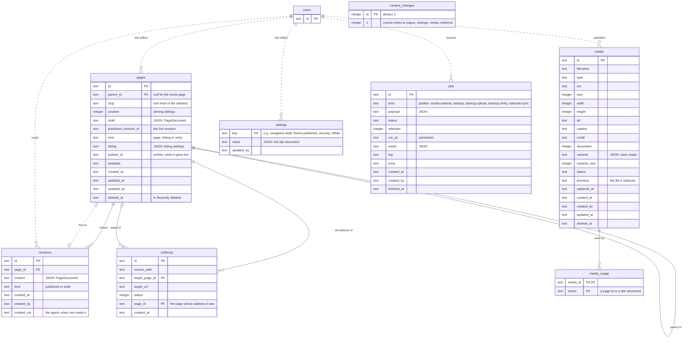
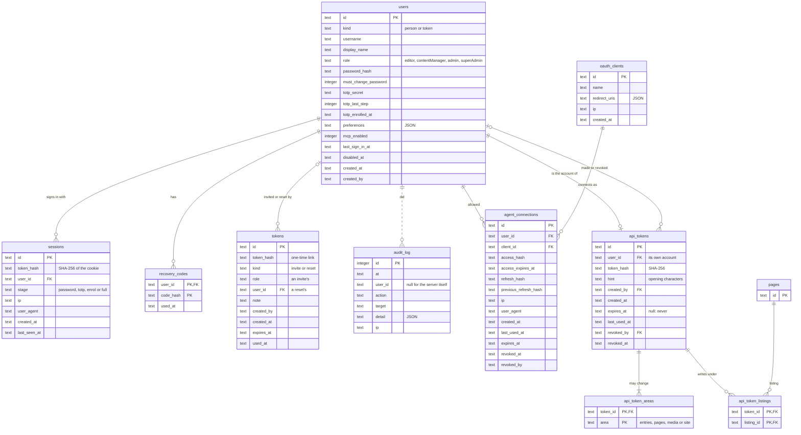
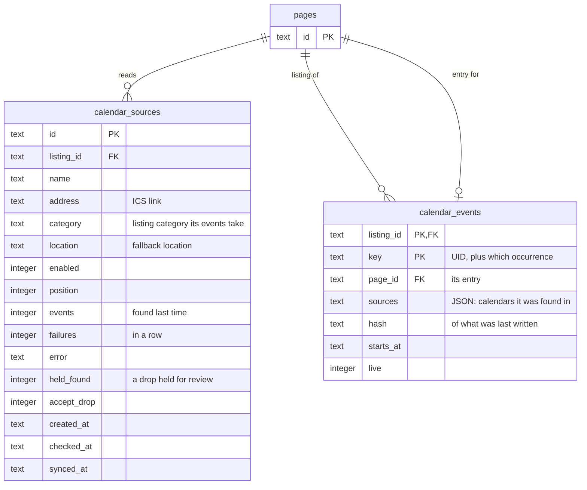
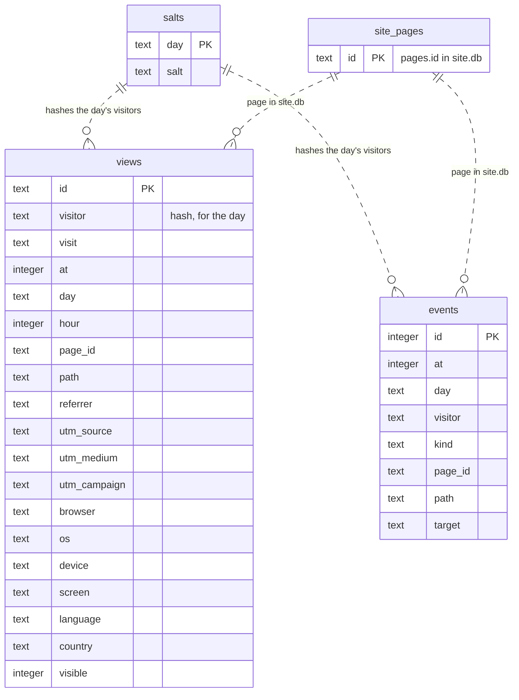

# Databases

Laman keeps two SQLite files in `DATA_DIR`: `site.db` (content, people and access) and `analytics.db` (visits, kept apart so it can be cleared without touching the site). Both are made by `0001_baseline` (docs/upgrades.md § The baseline). Table types for the server are in `apps/server/src/db/schema.ts`.

How to read the diagrams:

- **Solid lines** are foreign keys SQLite enforces.
- **Dashed lines** are references the code keeps but SQLite doesn't check: who made or last changed something, a page's live revision, and `analytics.db`'s pages, which live in the other file.
- `text` columns ending `_at` hold ISO times. Columns described as JSON hold a document whose schema is listed in `apps/server/src/db/documents.ts`.
- Kysely's own `kysely_migration` and `kysely_migration_lock` are left out of both files.

The diagrams are drawn from a freshly migrated database. Update them with any migration that adds or changes a table.

## site.db: content

Pages form one tree (the home page is the root). A listing collects entries, which are pages of kind `entry` under it. Drafts are saved on the page; publishing freezes one as a revision.

## site.db: people and access

People sign in with a session. Agents connect over OAuth (docs/mcp.md). API tokens each have an account of their own (`users.kind` "token") that never signs in (docs/auth.md § API tokens).

## site.db: Takwim

A listing reads ICS calendars. Each occurrence a sync finds is written to an entry under the listing; `calendar_events` remembers which entry, and a hash of what it last wrote (docs/site-builder.md).

## analytics.db

No visitor is identified across days: `visitor` is a hash made with that day's salt, which is replaced the next day (docs/analytics.md). `page_id` points at a page in `site.db`, which SQLite can't check across files.

