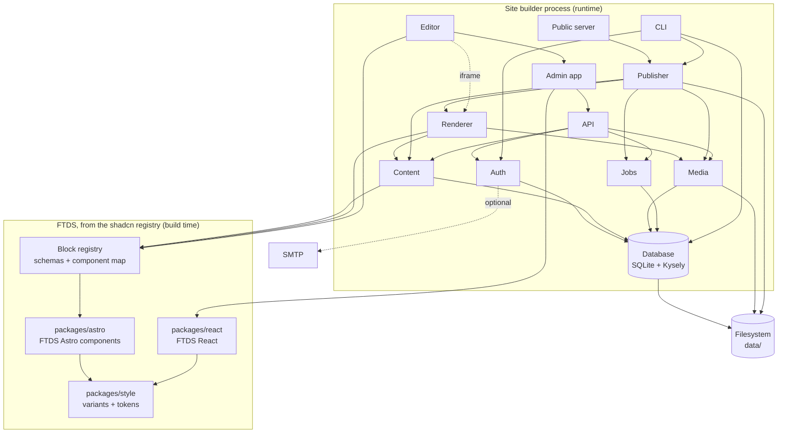

# RFC: FTDS Site Builder

Status: draft. Architecture only; no code yet.

## Summary

A self-hosted website builder for agency sites, in the spirit of Isomer and WordPress, with a visual editor in the spirit of Builder.io. Each agency installs and runs its own copy. Editors build pages by arranging FTDS blocks on a live canvas, edit text in place, and press Publish to produce a static site.

## Constraints

| Topic     | Decision                                                                                 |
| --------- | ---------------------------------------------------------------------------------------- |
| Tenancy   | Single-tenant. One install is one site. No shared cloud, nothing for us to operate.      |
| Storage   | SQLite only (one file), plus a media folder on disk. No Git-based content.               |
| Build     | From scratch. No Payload or other CMS underneath.                                        |
| Editing   | Drag and drop of FTDS blocks, inline text editing, property panel, preview.              |
| Freedom   | Editors arrange approved blocks and pick preset variants. No free styling.               |
| Workflow  | No approval layer. Draft and published versions, with history.                           |
| Auth      | Email and password.                                                                      |
| Install   | Docker image and native (Node, systemd).                                                 |
| Repo      | Its own repository, not the FTDS monorepo. FTDS components come in through the registry. |
| Runtime   | Node only. See Alternatives considered for why not Go.                                   |
| Output    | Static HTML, served by the same process or copied to any web server.                     |
| Languages | BM and EN, BM by default.                                                                |

## Shape: one process, several modules

There are no microservices. Everything below runs in one Node process with one SQLite file, so an agency installs one thing and backs up two paths. "Service" here means a module with a clear boundary, not a separate deployable.

There are two halves, and only one of them is a server:

- **The builder** (admin, API, editor, preview) is a server, because it has users, sessions, a database and a live canvas. Only editors reach it, ideally on an internal network or behind a VPN.
- **The published site** is completely static: HTML, CSS, images and a search index in `data/public`. No server code, no database, no JavaScript beyond what FTDS components need. It can be served by nginx, Caddy, an object store or a CDN, and keeps working if the builder is switched off.

The builder is one Node process made of three parts, each on a tool suited to it:

| Part             | Built with                                                                                       | Role                                                                                 |
| ---------------- | ------------------------------------------------------------------------------------------------ | ------------------------------------------------------------------------------------ |
| Admin and editor | React single-page app built with Rsbuild; FTDS React, TanStack Router and Query, dnd-kit, Tiptap | Everything interactive. Built to static files, served at `/admin`.                   |
| Server           | Fastify on Node, Kysely over SQLite                                                              | The process that runs: auth, content, media, jobs, publishing, the API under `/api`. |
| Renderer         | A small internal Astro build (`@astrojs/node`, middleware mode), mounted by Fastify at `/render` | Block tree in, HTML out, with the FTDS Astro components. Nothing else.               |

Astro is used only as a rendering engine, because only Astro renders `.astro` components. The editor canvas and preview need a page rendered from the current draft on request, and the publisher calls the same renderer once per page and writes the result to files, so what editors see is what visitors get, without a second renderer. Fastify is the single entry point: one process, one port.

## Services

| #   | Service            | Responsibility                                                                                                                                                                                                                                                                                                                                 |
| --- | ------------------ | ---------------------------------------------------------------------------------------------------------------------------------------------------------------------------------------------------------------------------------------------------------------------------------------------------------------------------------------------- |
| 1   | **Block registry** | Every block an editor can place: its Zod schema (fields, variants, defaults, limits), the FTDS component that renders it, its label and icon. Code, not data: agencies don't add blocks.                                                                                                                                                       |
| 2   | **Database**       | SQLite through Kysely (`better-sqlite3` dialect): typed queries, Kysely migrations, WAL mode. Tables for users, sessions, pages, revisions, navigation, settings, media, jobs, audit log.                                                                                                                                                      |
| 3   | **Auth**           | Email and password (argon2id), sessions in SQLite, login rate limiting, roles (admin, editor), password reset.                                                                                                                                                                                                                                 |
| 4   | **Content**        | Pages as a tree of blocks (JSON validated against the registry), page tree and slugs, BM/EN variants, navigation, footer and site settings, drafts, published revisions, history and restore.                                                                                                                                                  |
| 5   | **Media**          | Uploads, type and size checks, sharp resizing into responsive variants, alt text, files on disk under `data/media`.                                                                                                                                                                                                                            |
| 6   | **Renderer**       | The internal Astro build at `/render`: turns a page's block tree into HTML with the FTDS components, inside the site layout. Modes: `edit` (adds `data-ftds-block` / `data-ftds-field` hooks), `preview` (draft) and `publish` (published revision).                                                                                           |
| 7   | **Jobs**           | A small queue in a SQLite table, worked in-process: publish, image processing, scheduled backups. Survives restarts.                                                                                                                                                                                                                           |
| 8   | **Publisher**      | Snapshots the published revisions, renders through the renderer only the pages whose input changed since the last publish (a manifest of fingerprints lives in the published folder), copies changed media, builds the Pagefind index, sitemap and RSS, writes to a new folder and swaps it in atomically. `publish --full` writes everything. |
| 9   | **Public server**  | Serves the current published folder. Optional: a reverse proxy or another web server can serve the same folder instead.                                                                                                                                                                                                                        |
| 10  | **Admin app**      | React SPA built with Rsbuild, using FTDS React, at `/admin`: sign-in, dashboard, page tree, media library, navigation, settings, users, history. Hosts the editor.                                                                                                                                                                             |
| 11  | **Editor**         | Inside the admin: the canvas (an iframe showing the renderer in `edit` mode), an overlay for selection and drag and drop (dnd-kit), inline text and rich text (Tiptap), the property panel generated from block schemas, undo and redo. Talks to the canvas by `postMessage`.                                                                  |
| 12  | **API**            | Fastify routes under `/api` (JSON Schema validation, `@fastify/rate-limit`, session plugin), the only way the admin changes anything. Validates input against the registry, checks the session and role, writes the audit log.                                                                                                                 |
| 13  | **CLI**            | `init`, `migrate`, `create-admin`, `publish`, `backup`, `restore`. The same code the server uses; the Docker entrypoint and systemd unit call it.                                                                                                                                                                                              |
| 14  | **Analytics**      | Cookie-free visitor counts for the published site: an inline beacon posts to `/_v`, kept in `data/analytics.db`, reported in the admin. See `docs/analytics.md`.                                                                                                                                                                               |

### Outside the process

| Dependency    | Needed for                                  | Required?                                              |
| ------------- | ------------------------------------------- | ------------------------------------------------------ |
| Filesystem    | `data/site.db`, `data/media`, `data/public` | Yes. One volume holds all state.                       |
| SMTP server   | Password reset and invitations              | No. Without it an admin resets passwords from the CLI. |
| Reverse proxy | TLS, caching, serving `data/public`         | Recommended (Caddy or nginx), not required.            |

## Dependency graph

Arrows point from a module to what it depends on.



Layers, bottom up. Each depends only on layers below it:

1. **Design system**: `packages/style` → `packages/astro`, `packages/react`.
2. **Block registry**: the contract between the design system and the builder. Content, renderer and editor all read it, so one schema drives validation, rendering and the property panel.
3. **Storage**: Database and filesystem.
4. **Domain**: Auth, Content, Media, Jobs.
5. **Rendering and output**: Renderer, then Publisher.
6. **Interfaces**: API, Admin app and Editor, Public server, CLI.

Two rules keep the graph honest:

- **The block registry is the only bridge to FTDS.** Content and the editor never import a component; they go through the registry.
- **Only the API writes.** The admin and editor change data through it, so validation, permissions and the audit log live in one place.

## Repository and FTDS

The builder lives in its own repository. It is a product with its own releases, issues and install docs, and agencies who run it don't need the design system's source.

FTDS packages aren't published to npm; they ship through the shadcn registry. The builder consumes them the way any team does:

- The Astro components and blocks (`@ftds/astro-*`) are installed into the renderer, and FTDS React into the admin, with `npx shadcn add`. They are committed to the builder repo, so a builder release pins an exact version of each component.
- The block registry (schemas and the block-to-component map) lives in the builder repo, next to the components it describes.
- Upgrading FTDS is a deliberate change: re-run `shadcn add` for the changed items, review the diff, check the block schemas still match the props, release.

What this costs: a new FTDS block reaches the builder only when someone adds it there, and a prop change in FTDS can break a block schema silently. A test in the builder repo that renders every block with its default and example content catches most of that.

## Request flows

**Editing a page**

1. The admin loads the draft block tree from the API.
2. The canvas iframe loads the renderer in `edit` mode for that draft.
3. The overlay maps clicks to `data-ftds-block` and `data-ftds-field`; edits go to the admin over `postMessage`.
4. The admin applies the change locally (undo stack), saves the draft through the API (debounced), and the canvas re-renders the changed block.

**Publishing**

1. An editor presses Publish; the API marks the draft as the published revision and queues a publish job.
2. The publisher links the live files into `data/public.next`, renders only the pages whose input changed (see `docs/briefs/incremental-publishing.md`), copies changed media, runs Pagefind, writes the sitemap.
3. It swaps `data/public.next` into place. A failed build leaves the live site untouched.

## Site search

Search on the published site is Pagefind, run by the publisher through its Node API, so there's nothing to install and no search server. It's a drafted document of its own (`search`, edited on the admin's Search screen): on or off, filters by collection and category, and pinned results.

- **What's indexed:** each published page once, by its `<main data-pagefind-body>`, so the navbar, footer and announcement stay out. A listing's later and category pages, redirects and pages marked `noindex` aren't indexed. Every page carries a `koleksi` filter (its listing's title, from the entry render, or "Halaman") and entries a `kategori`; entries also carry their date, written as BM readers write it. Content is indexed as BM.
- **When it's built:** after the pages are in `public.next`, only when an indexed page's file or Pagefind's version changed; otherwise the live index is linked across unchanged. `pagefind-entry.json` carries the fingerprint of what the index was built from, and every other index file is fingerprinted by its content, so a rebuild writes only the files that changed. A failed index fails the publish, leaving the live site as it was. The renderer's element ids differ between renders and Pagefind records them, so a page rendered again gets a new fragment even when its text is the same.
- **On the site:** a Cari link in the navbar to `/carian`, a page the publisher renders (not one in the tree, so `carian` and `pagefind` are reserved under the home page). Its form is a plain GET, and a small inline script answers it from `/pagefind/pagefind.js`; without JavaScript the page says so and lists the main sections. Pinned results are in `carian/pins.json`, keyed by word, and come first when the query is exactly one of them (and no filter is ticked). Pins to unpublished pages are left out, and the Search screen warns about them.
- **In the admin:** "Try a search" loads the live index from the builder's own origin and puts the draft's pins on top, so a pin can be checked before it's published.

## Site colours

An agency's site can use its own primary colour in place of FTDS Blue. It's a drafted document of its own (`theme`, edited on the admin's Colours screen): a tested preset, or one colour code.

- **How it reaches the page:** FTDS's semantic tokens (`--bg-primary-600`, `--txt-primary`, `--fr-primary`, …) all point at eleven primitives, `--_primary-50` to `--_primary-950`, and `@theme inline` reads them at run time. The layout writes the site's ramp over those primitives in an inline `<style id="site-theme">` on `html:root`, so every button, link, tag and focus ring follows with no Tailwind build and no edit to the FTDS files. Every page carries it, FTDS Blue included, so the page has one shape. The theme is in the render input, so publishing it re-renders every page through the fingerprints.
- **Making a ramp:** `rampFrom` in `packages/blocks/src/theme.ts`, in OKLCH. The colour becomes 600 (links and buttons) when it's dark enough to read on white, otherwise 500 (focus ring), otherwise the light step nearest it; the other steps follow FTDS Blue's curve in its hue. 500, 600 and 700 are then darkened where needed until `rampPasses`: 4.5:1 for links and buttons on white, `bg-washed` and the 50 wash, for 700 on white and on 100, and 3:1 for the focus ring.
- **What's stored:** the choice and the ramp the server made from it on save, so what was reviewed is what goes live, and a better generator never re-colours a live site by itself. The server refuses to store a ramp that fails the checks.
- **What doesn't change:** danger, warning, success and the greys, and the admin, which stays FTDS Blue. The canvas uses the draft theme; the Colours screen previews the home page with the unsaved choice (`POST /render/pages/:id/site` with `theme`), swapping in its `#site-theme` as the officer chooses.

## Deployment

```
data/
  site.db        SQLite (WAL)
  media/         originals and resized variants
  public/        the published site
```

- **Docker**: one image, one volume at `/data`, one port. `docker run -v ftds:/data -p 8080:8080 ftds/site-builder`.
- **Native**: `npx @ftds/site-builder init`, then a systemd unit that runs the server. Node LTS is the only prerequisite.
- **Backup**: see Backup and restore below.
- **Upgrades**: a new image or package version runs migrations on start, after an automatic backup.

## Backup and restore

### What gets backed up

| Path      | Backed up | Why                                                                                                    |
| --------- | --------- | ------------------------------------------------------------------------------------------------------ |
| `site.db` | Yes       | All content, users, history and settings.                                                              |
| `media/`  | Originals | Resized variants are rebuilt from the originals on restore.                                            |
| `public/` | No        | Rebuilt by publishing after a restore.                                                                 |
| Secrets   | No        | The session secret and SMTP password live in the environment or config file, which the operator keeps. |

### The one rule: never copy `site.db` while the server runs

SQLite in WAL mode keeps recent writes in `site.db-wal`. Copying `site.db` (or the whole folder with `cp`, `docker cp` or `rsync`) while the server runs can capture a database without its latest writes, or a torn one. Every backup goes through SQLite instead: `VACUUM INTO` (or better-sqlite3's online backup), which writes a consistent, compacted copy without stopping the site. A filesystem snapshot that is atomic for the whole volume (ZFS, LVM, a cloud disk snapshot) is also safe, since SQLite recovers from it as from a power cut.

### The backup command

`site-builder backup` is the same in every install format:

1. `VACUUM INTO` a temporary file, then `PRAGMA integrity_check` on the copy.
2. Archive the copy, the media originals and a `manifest.json` (builder version, migration version, file checksums, time) into `site-builder-<timestamp>.tar.gz`.
3. Write it to the backup directory (`BACKUP_DIR`) and delete archives beyond the retention setting (default: 7 daily, 4 weekly).

`--db-only` skips media, for frequent database backups on sites with a large media library; media then goes off-site with an incremental tool instead (below).

The server runs the same command as a scheduled job (daily by default) and before every upgrade's migrations. The admin shows when the last backup ran and whether it passed its integrity check.

### Getting backups off the machine

A backup on the same disk as the site doesn't survive losing that disk. The builder writes archives to `BACKUP_DIR`; moving them elsewhere is the operator's job, with the tools their infrastructure already uses. The docs recommend restic (encrypted, deduplicated, to S3-compatible storage or another server) pointed at `BACKUP_DIR`.

### Docker

```
docker run \
  -v ftds-data:/data \
  -v /srv/backups/ftds:/backups \
  -e BACKUP_DIR=/backups \
  -p 8080:8080 ftds/site-builder
```

- `/data` is a named volume (or a bind mount); `/backups` is a **separate bind mount** on the host, so archives are ordinary host files that host tools (restic, the host's own backup agent) can reach, and so removing the data volume doesn't remove the backups.
- The scheduled job writes there on its own. For a backup now: `docker exec <container> site-builder backup`.
- Don't back up by copying the volume (`docker cp`, `tar` of `/var/lib/docker/volumes`) while the container runs; use the archives, or an atomic snapshot of the host disk.
- Restore: stop the container, then `docker run --rm -v ftds-data:/data -v /srv/backups/ftds:/backups ftds/site-builder restore /backups/<archive>`, then start it again.

### Native

- Data lives in `/var/lib/ftds-site-builder`, backups in `/var/backups/ftds-site-builder`, both owned by the service user with `0700`, archives `0600`.
- `init` installs the systemd service. The scheduled job runs inside the server; operators who prefer the system scheduler can turn it off and enable the bundled `site-builder-backup.timer` instead, which runs the same command (and still works if the server is down).
- The host's existing backup agent, or restic, picks up `/var/backups/ftds-site-builder`.
- Restore: `systemctl stop ftds-site-builder`, `site-builder restore <archive>` as the service user, `systemctl start ftds-site-builder`.

### Restore

`site-builder restore <archive>` is the same in both formats:

1. Refuse to run while the server is running (a lock file in `data/`).
2. Check the manifest's checksums, and that the archive's migration version is not newer than this build's.
3. Move the current `site.db` and `media/` aside (not deleted) and unpack the archive.
4. Run any pending migrations, rebuild media variants, and queue a publish so `public/` matches the restored content.

`site-builder backup --verify <archive>` does steps 1–2 and an integrity check into a temporary folder without touching the site, so operators can test restores routinely.

### Point-in-time recovery (optional)

Daily archives can lose up to a day of edits. Agencies that need better can run Litestream, which streams the WAL to S3-compatible storage continuously: as a sidecar container for Docker, or a second systemd service natively. It's documented, not bundled, so the default install stays one process.

## Security

- The canvas iframe is same-origin (it needs the session) but runs no editor code itself; the overlay script is injected by the admin, and messages are checked by origin and shape.
- Block content is data validated against schemas, never HTML from editors. Rich text is stored as Tiptap JSON and rendered through an allow-list.
- Uploads are checked by content type, re-encoded by sharp where they are images, and served with `Content-Disposition` for anything else.
- The public site is static files: no database, no session, nothing to attack at runtime.

## Phases

3. **Block model**: the block registry package, schemas for the existing Astro blocks, a renderer that turns a JSON tree into a page.
4. **Building blocks and page templates**: as in `docs/rfc/astro.md`; templates become starting block trees.
5. **Builder MVP**: database, auth, content, media, API, admin, the editor (select, reorder, inline edit, property panel), publish to static. Docker and native installs.
6. **Complete builder**: history and restore, navigation editor, BM/EN side by side, Pagefind (built), scheduled publishing, backups from the admin, invitations by email.

## Alternatives considered

### Go for the server (rejected)

A compiled Go server would ship as one small binary with few third-party dependencies. It was rejected because it doesn't remove Node:

- `.astro` components compile to JavaScript and only run in a JavaScript runtime, and the renderer is needed on every canvas update, preview and publish. A Go server would need a Node renderer beside it: two runtimes, two processes and a connection between them, so the install gets heavier, not lighter.
- Embedding a JavaScript engine in Go (goja, QuickJS) to run Astro is unsupported, slow and fragile.
- Rewriting the blocks as Go templates (templ, `html/template`) would make a third copy of every component, beside React and Astro, and it would drift from FTDS.

Node is kept light instead: a short, fixed list of server dependencies (Fastify, Kysely, better-sqlite3, an argon2 library, sharp, Zod, the Astro runtime), the server bundled into one file at release, a distroless Docker image, `pnpm audit` and Renovate in CI, and possibly a Node single executable for native installs (native modules need testing first).

Revisit Go only if rendering leaves the server, for example if publishing moves to a separate build step or the editor renders blocks in the browser.

## Open questions

- Whether the public server is part of the product or always left to a reverse proxy.
- One site language at a time or BM and EN edited side by side from the start.
