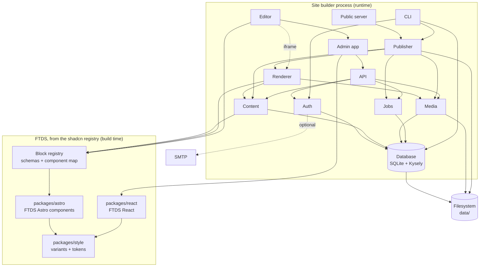

# RFC: FTDS Site Builder

Status: draft. Architecture only; no code yet.

## Summary

A self-hosted website builder for agency sites, in the spirit of Isomer and WordPress, with a visual editor in the spirit of Builder.io. Each agency installs and runs its own copy. Editors build pages by arranging FTDS blocks on a live canvas, edit text in place, and press Publish to produce a static site.

## Constraints

| Topic     | Decision                                                                                 |
| --------- | ---------------------------------------------------------------------------------------- |
| Tenancy   | Single-tenant. One install is one site. No shared cloud, nothing for us to operate.      |
| Storage   | SQLite only (one file), plus a media folder on disk. No Git-based content.               |
| Build     | From scratch. No Payload or other CMS underneath.                                        |
| Editing   | Drag and drop of FTDS blocks, inline text editing, property panel, preview.              |
| Freedom   | Editors arrange approved blocks and pick preset variants. No free styling.               |
| Workflow  | No approval layer. Draft and published versions, with history.                           |
| Auth      | Username and password, with TOTP two-factor. No mail server. See [auth.md](auth.md).     |
| Install   | Docker image and native (Node, systemd).                                                 |
| Repo      | Its own repository, not the FTDS monorepo. FTDS components come in through the registry. |
| Runtime   | Node only. See Alternatives considered for why not Go.                                   |
| Output    | Static HTML, served by the same process or copied to any web server.                     |
| Languages | BM and EN, BM by default.                                                                |

## Shape: one process, several modules

There are no microservices. Everything below runs in one Node process with one SQLite file, so an agency installs one thing and backs up two paths. "Service" here means a module with a clear boundary, not a separate deployable.

There are two halves, and only one of them is a server:

- **The builder** (admin, API, editor, preview) is a server, because it has users, sessions, a database and a live canvas. Only editors reach it, ideally on an internal network or behind a VPN.
- **The published site** is completely static: HTML, CSS, images and a search index in `data/public`. No server code, no database, no JavaScript beyond what FTDS components need. It can be served by nginx, Caddy, an object store or a CDN, and keeps working if the builder is switched off.

The builder is one Node process made of three parts, each on a tool suited to it:

| Part             | Built with                                                                                       | Role                                                                                 |
| ---------------- | ------------------------------------------------------------------------------------------------ | ------------------------------------------------------------------------------------ |
| Admin and editor | React single-page app built with Rsbuild; FTDS React, TanStack Router and Query, dnd-kit, Tiptap | Everything interactive. Built to static files, served at `/admin`.                   |
| Server           | Fastify on Node, Kysely over SQLite                                                              | The process that runs: auth, content, media, jobs, publishing, the API under `/api`. |
| Renderer         | A small internal Astro build (`@astrojs/node`, middleware mode), mounted by Fastify at `/render` | Block tree in, HTML out, with the FTDS Astro components. Nothing else.               |

Astro is used only as a rendering engine, because only Astro renders `.astro` components. The editor canvas and preview need a page rendered from the current draft on request, and the publisher calls the same renderer once per page and writes the result to files, so what editors see is what visitors get, without a second renderer. Fastify is the single entry point: one process, one port.

## Services

| #   | Service            | Responsibility                                                                                                                                                                                                                                                                                                                                 |
| --- | ------------------ | ---------------------------------------------------------------------------------------------------------------------------------------------------------------------------------------------------------------------------------------------------------------------------------------------------------------------------------------------- |
| 1   | **Block registry** | Every block an editor can place: its Zod schema (fields, variants, defaults, limits), the FTDS component that renders it, its label and icon. Code, not data: agencies don't add blocks.                                                                                                                                                       |
| 2   | **Database**       | SQLite through Kysely (`better-sqlite3` dialect): typed queries, Kysely migrations, WAL mode. Tables for users, sessions, pages, revisions, navigation, settings, media, jobs, audit log.                                                                                                                                                      |
| 3   | **Auth**           | Username and password (argon2id), TOTP two-factor, sessions in SQLite, sign-in throttling, roles (Editor, Content Manager, Admin, super admin), one-time invite and reset links, an audit log. See [auth.md](auth.md).                                                                                                                         |
| 4   | **Content**        | Pages as a tree of blocks (JSON validated against the registry), page tree and slugs, BM/EN variants, navigation, footer and site settings, drafts, published revisions, history and restore.                                                                                                                                                  |
| 5   | **Media**          | Uploads, type and size checks, sharp resizing into responsive variants, alt text, files on disk under `data/media`.                                                                                                                                                                                                                            |
| 6   | **Renderer**       | The internal Astro build at `/render`: turns a page's block tree into HTML with the FTDS components, inside the site layout. Modes: `edit` (adds `data-ftds-block` / `data-ftds-field` hooks), `preview` (draft) and `publish` (published revision).                                                                                           |
| 7   | **Jobs**           | A small queue in a SQLite table, worked in-process: publish, image processing, scheduled backups. Survives restarts.                                                                                                                                                                                                                           |
| 8   | **Publisher**      | Snapshots the published revisions, renders through the renderer only the pages whose input changed since the last publish (a manifest of fingerprints lives in the published folder), copies changed media, builds the Pagefind index, sitemap and RSS, writes to a new folder and swaps it in atomically. `publish --full` writes everything. |
| 9   | **Public server**  | Serves the current published folder. Optional: a reverse proxy or another web server can serve the same folder instead.                                                                                                                                                                                                                        |
| 10  | **Admin app**      | React SPA built with Rsbuild, using FTDS React, at `/admin`: sign-in, dashboard, page tree, media library, navigation, settings, users, history. Hosts the editor.                                                                                                                                                                             |
| 11  | **Editor**         | Inside the admin: the canvas (an iframe showing the renderer in `edit` mode), an overlay for selection and drag and drop (dnd-kit), inline text and rich text (Tiptap), the property panel generated from block schemas, undo and redo. Talks to the canvas by `postMessage`.                                                                  |
| 12  | **API**            | Fastify routes under `/api` (JSON Schema validation, `@fastify/rate-limit`, session plugin), the only way the admin changes anything. Validates input against the registry, checks the session and role, writes the audit log.                                                                                                                 |
| 13  | **CLI**            | `init`, `migrate`, `create-admin`, `publish`, `backup`, `restore`. The same code the server uses; the Docker entrypoint and systemd unit call it.                                                                                                                                                                                              |
| 14  | **Analytics**      | Cookie-free visitor counts for the published site: an inline beacon posts to `/_v`, kept in `data/analytics.db`, reported in the admin. See `docs/analytics.md`.                                                                                                                                                                               |

### Outside the process

| Dependency    | Needed for                                  | Required?                                              |
| ------------- | ------------------------------------------- | ------------------------------------------------------ |
| Filesystem    | `data/site.db`, `data/media`, `data/public` | Yes. One volume holds all state.                       |
| SMTP server   | Password reset and invitations              | No. Without it an admin resets passwords from the CLI. |
| Reverse proxy | TLS, caching, serving `data/public`         | Recommended (Caddy or nginx), not required.            |

## Dependency graph

Arrows point from a module to what it depends on.



Layers, bottom up. Each depends only on layers below it:

1. **Design system**: `packages/style` → `packages/astro`, `packages/react`.
2. **Block registry**: the contract between the design system and the builder. Content, renderer and editor all read it, so one schema drives validation, rendering and the property panel.
3. **Storage**: Database and filesystem.
4. **Domain**: Auth, Content, Media, Jobs.
5. **Rendering and output**: Renderer, then Publisher.
6. **Interfaces**: API, Admin app and Editor, Public server, CLI.

Two rules keep the graph honest:

- **The block registry is the only bridge to FTDS.** Content and the editor never import a component; they go through the registry.
- **Only the API writes.** The admin and editor change data through it, so validation, permissions and the audit log live in one place.

## Repository and FTDS

The builder lives in its own repository. It is a product with its own releases, issues and install docs, and agencies who run it don't need the design system's source.

FTDS packages aren't published to npm; they ship through the shadcn registry. The builder consumes them the way any team does:

- The Astro components and blocks (`@ftds/astro-*`) are installed into the renderer, and FTDS React into the admin, with `npx shadcn add`. They are committed to the builder repo, so a builder release pins an exact version of each component.
- The block registry (schemas and the block-to-component map) lives in the builder repo, next to the components it describes.
- Upgrading FTDS is a deliberate change: re-run `shadcn add` for the changed items, review the diff, check the block schemas still match the props, release.

What this costs: a new FTDS block reaches the builder only when someone adds it there, and a prop change in FTDS can break a block schema silently. A test in the builder repo that renders every block with its default and example content catches most of that.

## Request flows

**Editing a page**

1. The admin loads the draft block tree from the API.
2. The canvas iframe loads the renderer in `edit` mode for that draft.
3. The overlay maps clicks to `data-ftds-block` and `data-ftds-field`; edits go to the admin over `postMessage`.
4. The admin applies the change locally (undo stack), saves the draft through the API (debounced), and the canvas re-renders the changed block.

**Saving safely**

- **Nobody overwrites anyone.** Every draft (a page's, a site document's) has a version that changes when it does (`draftVersion`, `version`). A save sends the version it started from as `base`; if someone else saved in between, it's refused with 409 `draft_conflict`, naming who and when (`apps/server/src/content/versions.ts`). The admin asks: load theirs, or keep mine, which saves again over theirs. A page's refused copy is kept in its history, so loading theirs loses nothing. A save without `base` (a script) still wins, as before.
- **A sign-in that runs out doesn't lose work.** Any 401 while signed in opens "Sign in again" over the screen (`apps/admin/src/auth/sign-in-again.tsx`), with the two-factor step if they use it; the editor's save carries on after. "Go to Sign in" is there for someone else at the keyboard.
- **Unsaved page changes are kept in the browser** (`localStorage`, per person, cleared at sign-out) until they're saved, so a closed tab or a crash doesn't lose them: the editor offers them back, saved from the version they started from.
- **The editor says why it isn't saving, and only retries what time can fix:** invalid fields, a conflict, a lost sign-in, a page deleted or no longer theirs to edit each stop with their own message; a server that can't be reached is retried, less often each time (3 s up to a minute). Publishing waits for the save and doesn't go ahead without it.

**Publishing**

1. An editor presses Publish; the API marks the draft as the published revision and queues a publish job.
2. The publisher links the live files into `data/public.next`, renders only the pages whose input changed (see `docs/briefs/incremental-publishing.md`), copies changed media, runs Pagefind, writes the sitemap.
3. It swaps `data/public.next` into place. A failed build leaves the live site untouched.

**One broken page doesn't block the rest.** A page that fails to render keeps the copy the live site has (a new page just stays off the site, the sitemap and the search index), out of the manifest's new fingerprints so the next publish tries it again, and the publish carries on. The job finishes with `failed` in its result and the page, with the block that broke it, in its log; the admin shows "Published, 1 page skipped" and links to the page.

## Checks before publishing

`apps/server/src/content/checks.ts` (`GET /api/pages/checks?ids=…`, several pages at once) looks at a page's draft for what would fail visitors, by walking its blocks' JSON rather than with a rule per block:

| Check                                                                                 | What happens     |
| ------------------------------------------------------------------------------------- | ---------------- |
| No Hero or Page intro, so no h1 (pages and listings; an entry's title is its heading) | Stops publishing |
| An image with no alt text that isn't marked decorative                                | Warning          |
| Alt text that's a file name (`IMG_2041.png`) or a word like "gambar"                  | Warning          |
| A link to a page that isn't live yet, or to an address the site doesn't have          | Warning          |
| Example text from a block's defaults or a template, left in                           | Warning          |
| Link text such as "klik sini", "di sini", "read more"                                 | Warning          |

The editor's Publish shows them first, each with what to do and **Show**, which selects the block; with only warnings it reads **Publish anyway**. On Publishing and in the waiting drawer each page says how many there are, and one that a check stops can't be ticked. The server refuses to publish such a page (409 `page_not_ready`) whichever way it's asked. Drafts can always be saved: the check is about going live, not about work in progress.

It can't judge everything: whether alt text is good, whether text is plain, or what a PDF contains. Those stay with the officer.

## Site search

Search on the published site is Pagefind, run by the publisher through its Node API, so there's nothing to install and no search server. It's a drafted document of its own (`search`, edited on the admin's Search screen): on or off, filters by collection and category, and pinned results.

- **What's indexed:** each published page once, by its `<main data-pagefind-body>`, so the navbar, footer and announcement stay out. A listing's later and category pages, redirects and pages marked `noindex` aren't indexed. Every page carries a `koleksi` filter (its listing's title, from the entry render, or "Halaman") and entries a `kategori`; entries also carry their date, written as BM readers write it. Content is indexed as BM.
- **When it's built:** after the pages are in `public.next`, only when an indexed page's file or Pagefind's version changed; otherwise the live index is linked across unchanged. `pagefind-entry.json` carries the fingerprint of what the index was built from, and every other index file is fingerprinted by its content, so a rebuild writes only the files that changed. A failed index fails the publish, leaving the live site as it was. The renderer's element ids differ between renders and Pagefind records them, so a page rendered again gets a new fragment even when its text is the same.
- **On the site:** a Cari link in the navbar to `/carian`, a page the publisher renders (not one in the tree, so `carian` and `pagefind` are reserved under the home page). Its form is a plain GET, and a small inline script answers it from `/pagefind/pagefind.js`; without JavaScript the page says so and lists the main sections. Pinned results are in `carian/pins.json`, keyed by word, and come first when the query is exactly one of them (and no filter is ticked). Pins to unpublished pages are left out, and the Search screen warns about them.
- **In the admin:** "Try a search" loads the live index from the builder's own origin and puts the draft's pins on top, so a pin can be checked before it's published.

## Site colours

An agency's site can use its own primary colour in place of FTDS Blue. It's a drafted document of its own (`theme`, edited on the admin's Colours screen): a tested preset, or one colour code.

- **How it reaches the page:** FTDS's semantic tokens (`--bg-primary-600`, `--txt-primary`, `--fr-primary`, …) all point at eleven primitives, `--_primary-50` to `--_primary-950`, and `@theme inline` reads them at run time. The layout writes the site's ramp over those primitives in an inline `<style id="site-theme">` on `html:root`, so every button, link, tag and focus ring follows with no Tailwind build and no edit to the FTDS files. Every page carries it, FTDS Blue included, so the page has one shape. The theme is in the render input, so publishing it re-renders every page through the fingerprints.
- **Making a ramp:** `rampFrom` in `packages/blocks/src/theme.ts`, in OKLCH. The colour becomes 600 (links and buttons) when it's dark enough to read on white, otherwise 500 (focus ring), otherwise the light step nearest it; the other steps follow FTDS Blue's curve in its hue. 500, 600 and 700 are then darkened where needed until `rampPasses`: 4.5:1 for links and buttons on white, `bg-washed` and the 50 wash, for 700 on white and on 100, and 3:1 for the focus ring.
- **What's stored:** the choice and the ramp the server made from it on save, so what was reviewed is what goes live, and a better generator never re-colours a live site by itself. The server refuses to store a ramp that fails the checks.
- **What doesn't change:** danger, warning, success and the greys, and the admin, which stays FTDS Blue. The canvas uses the draft theme; the Colours screen previews the home page with the unsaved choice (`POST /render/pages/:id/site` with `theme`), swapping in its `#site-theme` as the officer chooses.

## Blocks

Every block is one FTDS component (`packages/blocks/src/registry.ts`, mapped in `apps/renderer/src/blocks/BlockContent.astro`). A few rules sit above the components:

- **One opening per page.** Hero (home and campaign pages) and Page intro (every other page) each hold the page's only h1, so the API rejects a page with more than one of them (`kindIssues`). Entries get their Page intro from their fixed fields, so neither block is offered there. Page intro's breadcrumb is the page's place in the tree, by its ancestors' titles (`breadcrumb` in the render input).
- **The hero's choices are presets.** `layout` is `stacked` (text only), `split` (text beside a picture, `mediaPosition` picks the side) or `image` (the picture fills the band and the text sits on a solid panel over it, above it on phones, so its contrast never depends on the photo); `align` centres a stacked hero; `tone` is Paper, Well or the primary wash, never a solid primary band. A split or image hero without a picture is drawn stacked. The picture loads eagerly at high priority: it's the page's largest paint. Search, top tasks and figures add-ons wait for FTDS.
- **Fields can depend on others.** `panel(field, { when, help })` in `fields.ts`: the property panel shows a field only while its siblings hold the listed values (reading their defaults when unset), and hidden fields keep their values, so switching layout and back loses nothing.
- **Events are entries with an Event details block.** The Acara template's collection starts each entry with it (its `startingBlocks`). The listing still sorts by publish date, not the event's date; an event entry type would change that.
- **One filled button per choice.** Ways to do it (FTDS CtaCards) gives the filled button only to the way marked recommended, and the schema refuses more than one.
- **Links and Downloads are separate blocks.** Links (FTDS LinkList) are pages and websites; one on another host than `SITE_URL` gets the outgoing arrow and "(laman web luar)" in its name, worked out from the address. Downloads (FTDS DownloadList) are files from the media library, with type and size in each link.
- **The 404 page.** The publisher writes `404.html` (FTDS StatusPage `not-found`) in the site layout, and the builder sends it with a 404 for any address the site doesn't have. A reverse proxy serving `data/public` does the same with `error_page 404 /404.html;` (nginx) or `handle_errors { rewrite * /404.html; file_server }` (Caddy).
- **Addresses have no trailing slash.** Links, the sitemap and the canonical link all write `/berita`, so the builder serves `/berita` straight from `berita/index.html`, and sends `/berita/` one 301 to `/berita` (keeping the query).
- **Compressed once, at publish.** The publisher writes `.br` and `.gz` beside every HTML, CSS, JavaScript, JSON, XML, SVG and text file over 1 KB it wrote, in one pass before the swap, and removes them with the file. The builder sends the copy the browser accepts (`@fastify/static` `preCompressed`), so nothing is compressed per visit; the home page goes from about 32 KB to 7 KB. A full publish of 543 pages takes about 0.9 s instead of 0.8 s. The API, its reference, the canvas and the admin are compressed as they go out (`@fastify/compress`, registered only around them: the published site has its own copies).

### Serving the site from a reverse proxy

The builder serves the published site itself, and that's the simple choice. A proxy that serves `data/public` directly instead has to do the same three things, for example with nginx (and its brotli module):

```nginx
location / {
    root /var/lib/site-builder/public;
    gzip_static on;
    brotli_static on;
    rewrite ^(/.+)/$ $1 permanent;            # /berita/ → /berita
    try_files $uri $uri/index.html =404;      # /berita → berita/index.html
    error_page 404 /404.html;
}
```

Redirects made in the admin are in `redirects.json` beside the site, as `{ "/old": { "to": "/new", "status": 301 } }`; turn it into a `map` or `return` rules. The builder's own paths (`ownPath` in `apps/server/src/app.ts`: `/admin`, `/api`, `/render`, `/_astro`, `/media`, `/_v` and the rest) still go to the builder.

## Deployment

```
data/
  site.db        SQLite (WAL)
  media/         originals and resized variants
  public/        the published site
```

- **Docker** (built): one image, one volume at `/data`, one port, with Compose and optional Caddy for HTTPS. See [install-docker.md](install-docker.md).
- **Native**: `npx @ftds/site-builder init`, then a systemd unit that runs the server. Node LTS is the only prerequisite.
- **Backup**: see Backup and restore below.
- **Upgrades**: a new image or package version runs migrations on start, after an automatic database backup. See [upgrades.md](upgrades.md) for how stored content is kept readable.

## Backup and restore

Built in `apps/server/src/backup.ts`. Backups run from the command line, every day inside the server, before every upgrade, and from the admin (**Back up now** in Settings → About, for Admins and up). Restore is command-line only: it replaces every account, and it needs the server stopped.

### What gets backed up

| Path              | Backed up | Why                                                                                               |
| ----------------- | --------- | ------------------------------------------------------------------------------------------------- |
| `site.db`         | Yes       | All content, users, history and settings.                                                         |
| `media/`          | Yes       | The folders the database names: originals and their WebP sizes, so a restore needs no rebuilding. |
| `media-previous/` | Yes       | The file before each replace, so "Put back the previous file" still works after a restore.        |
| `analytics.db`    | On demand | Only with `--with-analytics`: figures, not content (`docs/analytics.md`).                         |
| `public/`         | No        | Rebuilt by the full publish a restore queues.                                                     |
| Secrets           | No        | The environment (`SUPER_ADMIN_*`, `TRUST_PROXY`, …) is the operator's to keep.                    |

An archive holds password hashes and two-factor secrets (sessions are stored only as hashes). It isn't encrypted: archives are `0600` in a `0700` folder, and the tool that copies them off the machine encrypts them (restic does).

### The one rule: never copy `site.db` while the server runs

SQLite in WAL mode keeps recent writes in `site.db-wal`. Copying `site.db` (or the whole folder with `cp`, `docker cp` or `rsync`) while the server runs can capture a database without its latest writes, or a torn one. Every backup goes through SQLite instead: `VACUUM INTO`, which writes a consistent, compacted copy without stopping the site. A filesystem snapshot that is atomic for the whole volume (ZFS, LVM, a cloud disk snapshot) is also safe, since SQLite recovers from it as from a power cut.

### The backup command

`site-builder backup [--db-only] [--with-analytics]`, safe while the server runs:

1. `VACUUM INTO` a scratch folder in `DATA_DIR`, then `PRAGMA integrity_check` on the copy, and the stored-documents check ([upgrades.md](upgrades.md)), so a backup that couldn't be restored fails now rather than on the day it's needed.
2. Hard-link the media folders the copy names beside it (a folder that's missing is listed, not fatal), and write `manifest.json`: builder version, last migration, time, counts, and every file's size and SHA-256.
3. Pack it into `site-builder-<time>.tar.gz` (`-db.tar.gz` with `--db-only`), written under a temporary name and renamed once complete, in `BACKUP_DIR`.
4. Delete old archives: the newest of each of the last `BACKUP_KEEP_DAILY` days (7) and `BACKUP_KEEP_WEEKLY` weeks (4) are kept, by Malaysian date, full and database-only archives apart. Only files named like an archive are touched.

`--db-only` is for frequent database backups on sites with a large media library; media then goes off-site with an incremental tool instead (below). `site-builder backups` lists the archives.

The server runs the same code as a `backup` job every day at `BACKUP_SCHEDULE` (Malaysian time, `02:00` by default; `off` turns it off), and one missed while the server was down runs when it starts. Before an upgrade's migrations it writes a database-only archive of the database as it was ([upgrades.md](upgrades.md) § 2). The admin shows the last archive, a failure since, and warns when there's been none for 2 days or when `BACKUP_DIR` isn't set (backups then go to `DATA_DIR/backups`, on the site's own disk; the server also warns at boot in production).

### Getting backups off the machine

A backup on the same disk as the site doesn't survive losing that disk. The builder writes archives to `BACKUP_DIR`; moving them elsewhere is the operator's job, with the tools their infrastructure already uses. The docs recommend restic (encrypted, deduplicated, to S3-compatible storage or another server) pointed at `BACKUP_DIR`.

### Docker

Built: `Dockerfile` and `compose.yaml` at the repository root. `/data` is a named volume; `/backups` is a bind mount of a host folder, so archives are ordinary host files that host tools (restic, the host's own backup agent) can reach, and removing the data volume doesn't remove the backups. The commands for backups, restore and upgrades are in [install-docker.md](install-docker.md).

### Native

Planned with the package (not built yet):

- Data lives in `/var/lib/ftds-site-builder`, backups in `/var/backups/ftds-site-builder`, both owned by the service user with `0700`, archives `0600`.
- `init` installs the systemd service. The scheduled job runs inside the server; operators who prefer the system scheduler set `BACKUP_SCHEDULE=off` and enable the bundled `site-builder-backup.timer` instead, which runs the same command (and still works if the server is down).
- The host's existing backup agent, or restic, picks up `/var/backups/ftds-site-builder`.
- Restore: `systemctl stop ftds-site-builder`, `site-builder restore <archive>` as the service user, `systemctl start ftds-site-builder`.

### Restore

`site-builder restore <archive>` (a path, or the name of one in `BACKUP_DIR`):

1. Refuse to run while the server is running. The server keeps `DATA_DIR/server.lock` and touches it every 10 seconds, so this works across containers, and a lock left by a crash goes stale after 30.
2. Unpack into a scratch folder in `DATA_DIR`: only plain files and folders, exactly the files the manifest lists, each matching its checksum, from a migration this build knows (an archive from a newer version is refused).
3. Open the unpacked database, which runs this build's migrations and the stored-documents check. Sign everyone out, queue a full publish (so `public/` matches), and record the restore in the audit log.
4. Only then move the current `site.db`, `media/` and `media-previous/` (and `analytics.db` when the archive has it) into `DATA_DIR/before-restore-<time>/`, not deleted, and move the restored ones in. A database-only archive leaves media as it is.

Accounts, passwords and two-factor go back to how they were when the backup was made. A failure at any step before 4 leaves the site untouched.

`site-builder backup --verify <archive>` does steps 2 and 3 in a scratch folder without touching the site, so operators can test restores routinely.

### Point-in-time recovery (optional)

Daily archives can lose up to a day of edits. Agencies that need better can run Litestream, which streams the WAL to S3-compatible storage continuously: as a sidecar container for Docker, or a second systemd service natively. It's documented, not bundled, so the default install stays one process.

## Security

- **Sign-in is decided on the route that matched**, not on the address as written, so no spelling of a builder path (`/%61pi/users`, `//api/users`) reaches a handler without a session (`apps/server/src/auth/guard.ts`). See [auth.md](auth.md) for sessions, roles and the sign-in limits.
- The canvas iframe is same-origin (it needs the session) and runs no editor code of its own: the admin reaches into it directly. Only the builder may frame its own pages (`frame-ancestors 'self'`).
- Block content is data validated against schemas, never HTML from editors. Rich text is stored as Tiptap JSON and rendered through an allow-list.
- **Uploads** are checked by their bytes, not their names. Photos are rewritten without their metadata (EXIF, including where they were taken), since the original is published too. **SVG that could run code is refused**, not cleaned: scripts and foreign content under any namespace prefix, event handlers, `javascript:`-style or non-raster `data:` links (entity-encoded too), animations that change a link, and DTD entities. Every SVG response is also sent with a sandboxing CSP, so a file that got past the check still couldn't run anything on the builder's origin.
- **Headers** (`apps/server/src/headers.ts`, by the paths in `apps/server/src/paths.ts`): `nosniff` and a referrer policy everywhere; HSTS when the request came over HTTPS; on the builder, `X-Frame-Options` and a strict CSP. The admin, the canvas and the previews in it load scripts only from the builder's own files, nothing inline and no `eval` (WebAssembly is allowed for the search preview), so a script that got into content can't run with an officer's session; styles may be inline. The API reference at `/docs` (Scalar) runs an inline script, so it gets only the framing rules. The published site's policy stays loose: it holds no session, and carries an inline analytics script and theme styles. A new admin feature that needs a script from elsewhere, or inline, has to change the policy; the browser's console says so.
- **Behind a proxy, set `TRUST_PROXY` to the proxy's address.** It decides whether the session cookie is `Secure` (`__Host-sb_session`), and the addresses the audit log and the sign-in limits see. In production the server warns at boot when it's unset, or set to `true` (which believes any client's `X-Forwarded-For`).
- The public site is static files: no database, no session, nothing to attack at runtime.

## Phases

3. **Block model**: the block registry package, schemas for the existing Astro blocks, a renderer that turns a JSON tree into a page.
4. **Building blocks and page templates**: as in `docs/rfc/astro.md`; templates become starting block trees.
5. **Builder MVP**: database, auth, content, media, API, admin, the editor (select, reorder, inline edit, property panel), publish to static. Docker and native installs.
6. **Complete builder**: history and restore, navigation editor, BM/EN side by side, Pagefind (built), scheduled publishing, backups (built: back up from the admin, restore from the CLI), invitations by email.

## Alternatives considered

### Go for the server (rejected)

A compiled Go server would ship as one small binary with few third-party dependencies. It was rejected because it doesn't remove Node:

- `.astro` components compile to JavaScript and only run in a JavaScript runtime, and the renderer is needed on every canvas update, preview and publish. A Go server would need a Node renderer beside it: two runtimes, two processes and a connection between them, so the install gets heavier, not lighter.
- Embedding a JavaScript engine in Go (goja, QuickJS) to run Astro is unsupported, slow and fragile.
- Rewriting the blocks as Go templates (templ, `html/template`) would make a third copy of every component, beside React and Astro, and it would drift from FTDS.

Node is kept light instead: a short, fixed list of server dependencies (Fastify, Kysely, better-sqlite3, an argon2 library, sharp, Zod, the Astro runtime), the server bundled into one file at release, a distroless Docker image, `pnpm audit` and Renovate in CI, and possibly a Node single executable for native installs (native modules need testing first).

Revisit Go only if rendering leaves the server, for example if publishing moves to a separate build step or the editor renders blocks in the browser.

## Open questions

- Whether the public server is part of the product or always left to a reverse proxy.
- One site language at a time or BM and EN edited side by side from the start.
